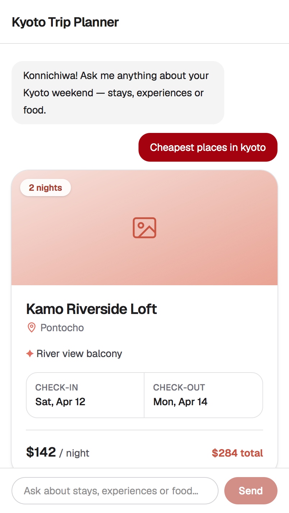
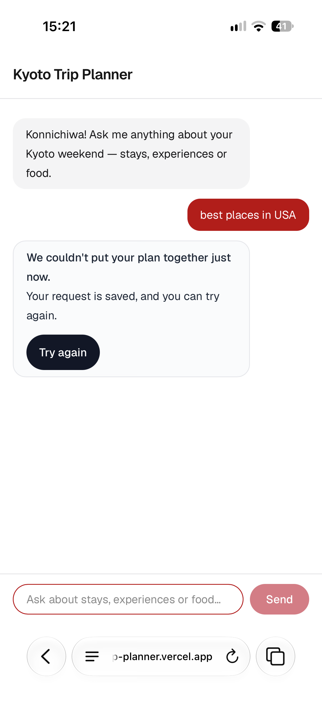
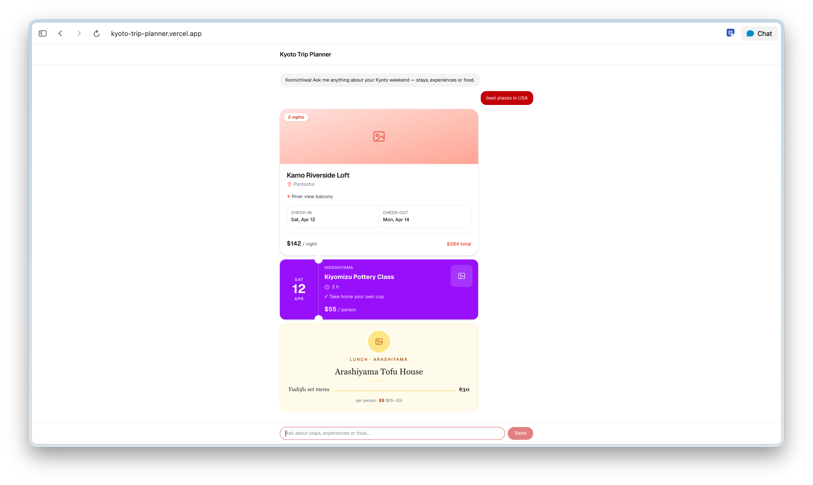
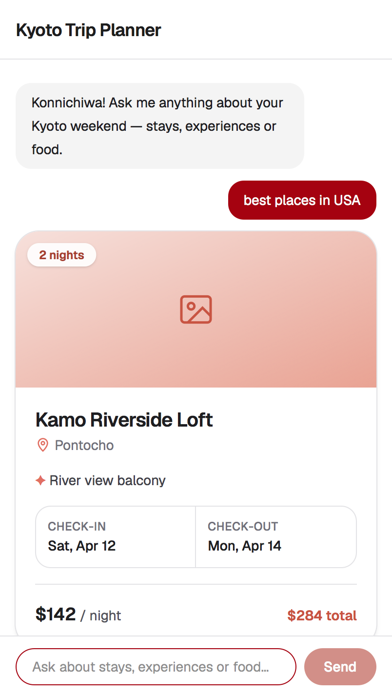

# Kyoto Trip Planner

**Try it:** https://kyoto-trip-planner.vercel.app (public, no login)

> This is a prototype with sample data. Nothing here is a real listing or booking.

A chat page that answers questions about a Kyoto weekend with stay, experience and food cards.

## Prototype session pass checklist

A device is ticked only when its screenshot in [Tested on phone and laptop](#tested-on-phone-and-laptop) shows the requirement. Blank means not yet checked on that device. Requirements that don't depend on the device are checked in the code.

| Requirement | Phone | Laptop | Proof |
| --- | :---: | :---: | --- |
| Guest message stays visible throughout | ✅ | ✅ | Phone [1](screenshots/phone-happy-flow.PNG), [2](screenshots/phone-error-bubble.png), [3](screenshots/phone-after-try_again-flow.PNG); Laptop [1](screenshots/Happy-flow.png), [2](screenshots/error-bubble.png), [3](screenshots/after-try_again-flow.png) |
| Thinking dots show before every reply | | | No screenshot shows the dots yet |
| Three cards appear (stay, Experience, food) | | ✅ | Laptop [1](screenshots/Happy-flow.png), [3](screenshots/after-try_again-flow.png); phone screenshots show only the stay card |
| Typing `best places in USA` shows the broken mock | ✅ | ✅ | Phone [2](screenshots/phone-error-bubble.png); Laptop [2](screenshots/error-bubble.png) |
| The error appears inside the assistant bubble with “We couldn’t put your plan together just now.” and “Your request is saved, and you can try again.” | ✅ | ✅ | Phone [2](screenshots/phone-error-bubble.png); Laptop [2](screenshots/error-bubble.png) |
| Exactly one “Try again” button, inside the bubble | ✅ | ✅ | Phone [2](screenshots/phone-error-bubble.png); Laptop [2](screenshots/error-bubble.png) |
| No red, no error codes, no alerts, toasts, modals or separate pages | ✅ | ✅ | Phone [2](screenshots/phone-error-bubble.png); Laptop [2](screenshots/error-bubble.png) |
| All three broken shapes (bad type, missing data, plain string) are rejected by `toResponseItems` | — | — | Code check: [src/lib/responseItems.ts](src/lib/responseItems.ts), shapes in [src/data/mockResponse.ts](src/data/mockResponse.ts) |
| Try again removes the failed bubble, shows the dots, then the three cards, and never picks the broken mock | | | Phone [3](screenshots/phone-after-try_again-flow.PNG) and Laptop [3](screenshots/after-try_again-flow.png) show the bubble gone and the cards back, but not the dots; phone shows only the stay card |
| `aria-live="polite"`, AA contrast, icon hidden from screen readers | — | — | Code check: [src/app/chat.tsx](src/app/chat.tsx) (`aria-live="polite"`, `text-gray-800` on `bg-gray-50`; the bubble has no icon) |
| Visible focus ring on Try again | | | Not captured; the classes are in [src/app/chat.tsx](src/app/chat.tsx) |
| 44px tap target on Try again | | | Not measured; `min-h-[44px]` is in [src/app/chat.tsx](src/app/chat.tsx) |
| Works on phone and laptop | ✅ | ✅ | Phone [1](screenshots/phone-happy-flow.PNG), [2](screenshots/phone-error-bubble.png), [3](screenshots/phone-after-try_again-flow.PNG); Laptop [1](screenshots/Happy-flow.png), [2](screenshots/error-bubble.png), [3](screenshots/after-try_again-flow.png) |
| Public Vercel link opens with no login | ✅ | ✅ | Phone [2](screenshots/phone-error-bubble.png) (vercel.app in the address bar); Laptop [1](screenshots/Happy-flow.png) |

## Tested on phone and laptop

Each step was run on the live Vercel link. The step names match the checklist rows they prove.

| Step | Laptop | Phone |
| --- | --- | --- |
| 1. Three cards appear (stay, Experience, food) |  |  |
| 2. Typing `best places in USA` shows the broken mock |  |  |
| 3. Try again removes the failed bubble, then the three cards |  |  |

## Forced-failure state

To fire the forced failure, type `best places in USA` as the whole message (any case); `src/app/chat.tsx` then sends the broken mock from `src/data/mockResponse.ts`.

## Card fields that use filler

Every text field (name, neighbourhood, dates, price, highlight) comes from a real row in `Kyoto_weekend_workbook.xlsx`. The one filler field is:

- **Photo**, on all three cards (`StayCard`, `ExperienceCard`, `FoodCard`): a placeholder image icon labelled "Photo of … coming soon". The workbook has no photo column yet.

## Run locally

Run it locally with `npm install && npm run dev`, then open http://localhost:3000.

## Message for the team and leaders

Checked against the [UX Research requirements note](docs/ux-research-note.md).

Hi team and leaders, the Kyoto Trip Planner prototype is ready for Thursday's session. The researcher shares this link with our 8 test guests; product team and leadership, please try it before and after: https://kyoto-trip-planner.vercel.app (public, no login, phone or laptop).

- **Happy path:** ask any Kyoto question, such as "cheapest trip in kyoto". You'll see thinking dots, then the stay, Experience and food cards.
- **Failure path:** type "best places in USA" to see the error bubble, then tap Try again: dots, then the three cards.

Everything is sample data; nothing is a real listing or can be booked.
