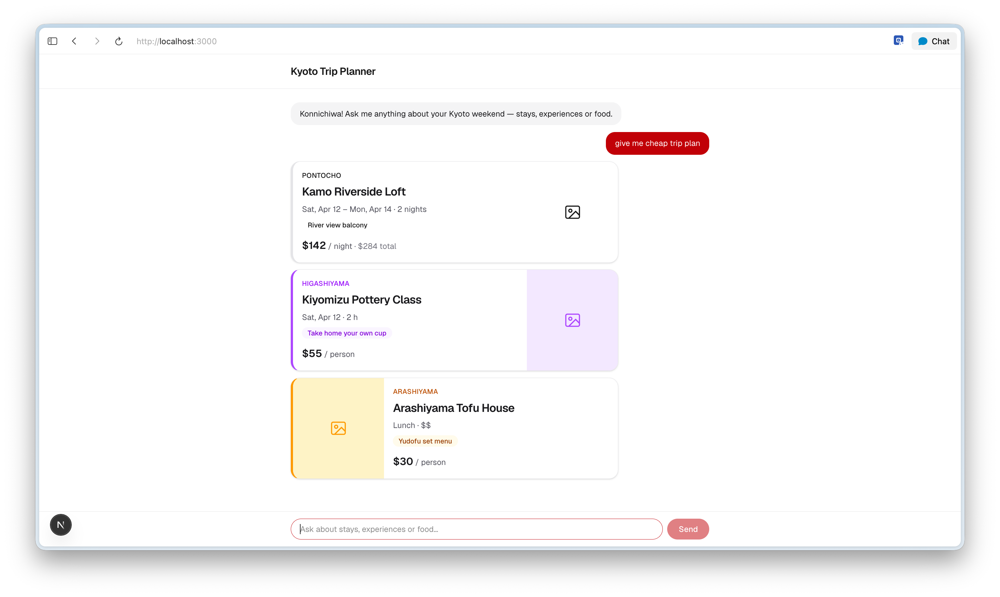
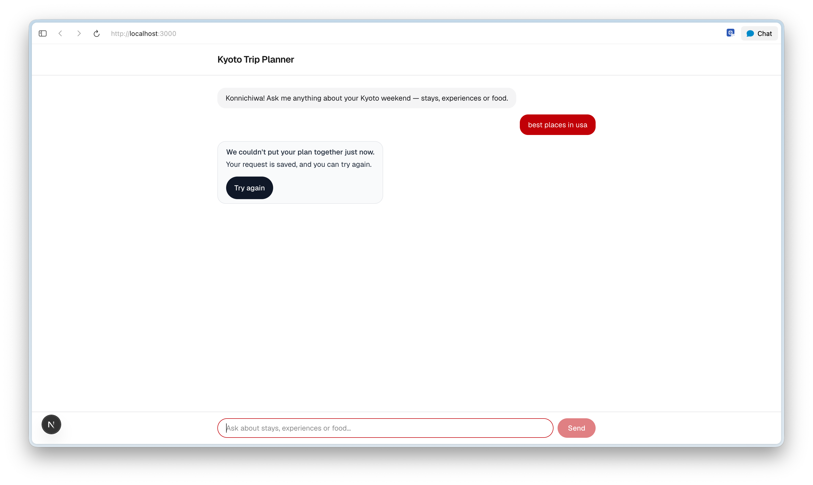
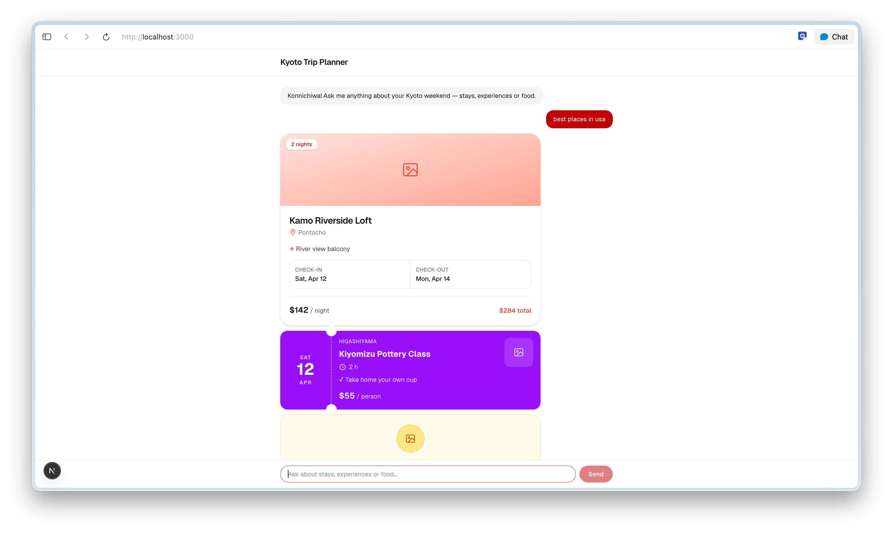

# Kyoto Trip Planner

A chat page that answers questions about a Kyoto weekend with stay, experience and food cards.

Run it locally with `npm install && npm run dev`, then open http://localhost:3000.

## Forced-failure state

To fire the forced failure, type `best places in USA` as the whole message (any case); `src/app/chat.tsx` then sends the broken mock from `src/data/mockResponse.ts`.

- [Error bubble](screenshots/error-bubble.png): the reply that can't become cards, with a Try again button.
- [Cards after retry](screenshots/cards-after-retry.png): Try again re-runs the happy-path mock and shows the stay, experience and food cards.

## Card fields that use filler

Every text field (name, neighbourhood, dates, price, highlight) comes from a real row in `Kyoto_weekend_workbook.xlsx`. The one filler field is:

- **Photo**, on all three cards (`StayCard`, `ExperienceCard`, `FoodCard`): a placeholder image icon labelled "Photo of … coming soon". The workbook has no photo column yet.
